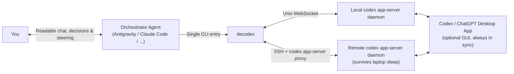

# DeCodex

> **Decode Codex**: Use your preferred conversational AI agent (Antigravity, Claude Code, etc.) as a human-readable translation, orchestration, and low-token dispatch layer over GPT/Codex.

[简体中文](./README.zh-CN.md)

## Why DeCodex?

Codex is great at grinding through real engineering work—editing repos, running experiments, and executing commands across local and remote SSH workstations—but its raw output is often verbose and hard for humans to scan quickly.

**DeCodex** splits responsibilities cleanly:
- **Your conversational agent** handles discussion, plan convergence, dispatching, mid-flight steering/queueing, and translating Codex's dense output into concise, first-hand verified summaries.
- **Codex (`app-server` daemon)** does the actual heavy lifting on your local machine or unattended remote SSH workstations, with every session natively visible and resumable in the **Codex / ChatGPT Desktop App**.

## Key Features

- **Zero external dependencies**: Single-file Python 3 stdlib CLI (`bin/decodex`) speaking RFC 6455 WebSocket JSON-RPC directly to Codex's shared `app-server` daemon.
- **Native Codex Desktop App visibility**: Reuses your existing local & remote Codex project folders and creates threads directly on the same `app-server` daemon (default title prefix `✦`). You do **not** need the GUI app open while jobs run—open it anytime to inspect full tool calls or take over manually.
- **Zero-token event-driven waiting**: No `sleep` polling, no giant log dumps. `decodex start` / `watch` blocks silently and wakes your orchestrator agent with a `< 2 KB` structured JSON envelope only on actionable events:
  - `MID_TURN_QUESTION` — Early non-blocking wakeup when Codex asks an async or commentary question while continuing other executable steps in the background.
  - `GUARDIAN_DENIED` — Captures Codex Guardian (`auto_review`) rejections with full rationale and supports native approval override via `decodex approve`.
  - `TURN_DONE` / `FAILED` — Returns concise final summary, `git status --short`, and local path to the full first-hand message.
  - `DISCONNECTED` — Safe recovery after laptop sleep or SSH drops (remote turns keep running inside the remote `codex app-server daemon`).
- **First-class mid-turn controls**:
  - `decodex steer` — Real-time non-interrupting guidance (`turn/steer`, auto-falls back to `turn/start` if the turn just completed).
  - `decodex queue` — Native next-turn queueing (`codex queue`).
  - `decodex approve` — Native Guardian denial override (`thread/approveGuardianDeniedAction`) + automatic continuation.
- **Autonomous model & effort selection (`decodex models --iq`)**: Reads available local models from `models_cache.json` and optionally attaches live [CodexRadar IQ scores](https://codexradar.com/#iq) (with a 6-hour local cache), letting your orchestrator pick the optimal `--model` and `--effort` per task and override them on follow-up turns via `decodex steer --model ... --effort ...`.
- **Upgrade-proof self-check**: `decodex doctor` verifies local/remote daemon version alignment and checks live RPC contract compatibility against `codex app-server generate-json-schema`.

## Architecture



## Quick Start

### Requirements
- Python 3.9+
- Codex CLI (`0.169+` recommended, or macOS ChatGPT.app with bundled Codex CLI)
- For remote hosts: passwordless SSH alias in `~/.ssh/config` with `codex` installed on the remote machine

### Install

```bash
git clone https://github.com/DaveBraid/decodex.git
cd decodex
./install.sh
```

Verify your local daemon and protocol compatibility:

```bash
decodex doctor --fix
# Include remote SSH hosts:
decodex doctor --hosts local,my-gpu-box
```

### Install the Agent Skill (Optional)

Copy or register `skills/decodex` in your agent's skill directory (or via your skill manager):

```bash
# Example: generic skills folder
cp -r skills/decodex ~/.gemini/config/skills/decodex
```

## Usage

```bash
# 1. Discover existing local & remote Codex App projects & available models
decodex projects
decodex projects --host my-gpu-box --query training
decodex models --iq

# 2. Start a task in an existing project and wait silently for events
decodex start \
  --host my-gpu-box \
  --project training \
  --model gpt-6.2-sol \
  --effort xhigh \
  --title "Run ablation baseline" \
  --prompt-file /tmp/plan.md

# 3. Inject mid-turn guidance without interrupting active work (or switch model/effort on next turn)
decodex steer --host my-gpu-box --thread <thread-id> --prompt "Switch lr to 3e-4"

# 4. Queue a follow-up task for after the current turn finishes
decodex queue --host my-gpu-box --thread <thread-id> --prompt "Generate comparison table next"

# 5. Approve a Guardian-denied action after human review
decodex approve --host my-gpu-box --thread <thread-id>

# 6. Check status or inspect full saved message / recent items
decodex status --host my-gpu-box --thread <thread-id>
decodex inspect --host my-gpu-box --thread <thread-id> --saved
decodex inspect --host my-gpu-box --thread <thread-id> --limit 10
```

## Configuration (Environment Variables)

| Variable | Default | Description |
| :--- | :--- | :--- |
| `DECODEX_TITLE_PREFIX` | `✦` | Prefix automatically added to thread titles in Codex App |
| `DECODEX_HOME` | `~/.decodex` | Local cache directory for thread metadata, `last_message.md`, and pending Guardian payloads |
| `CODEX_HOME` | `~/.codex` | Codex state directory (`state_5.sqlite`, `.codex-global-state.json`, daemon socket) |
| `DECODEX_CODEX_BIN` | auto-detected | Explicit path to the `codex` binary |
| `DECODEX_DOCTOR_HOSTS` | `local` | Comma-separated default host list for `decodex doctor` |

## Keeping Up with Codex Updates

Whenever you update Codex CLI or the macOS ChatGPT Desktop App, run:

```bash
decodex doctor --fix --hosts local,my-gpu-box
```

`decodex doctor` checks:
1. Whether your running local/remote `app-server` daemon matches the installed CLI version (`--fix` updates the local daemon automatically via `app-server daemon update --from-cli --yes`).
2. Whether all RPC methods, notifications, and payload fields used by `decodex` still match the latest `codex app-server generate-json-schema`.

## License

[MIT](./LICENSE)
