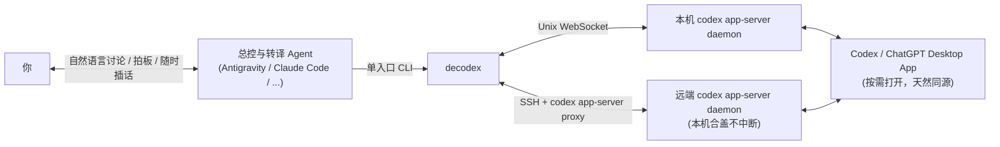

# DeCodex

> **解码 Codex**：用你顺手的对话式 Agent（如 Antigravity、Claude Code 等）作为 GPT/Codex 的**人话转译层、低 Token 调度层与统一沟通入口**。

[English](./README.md)

## 为什么做 DeCodex？

GPT / Codex 非常适合承担真正繁重的工程与实验执行（改代码、跑脚本、连远端工作站与 GPU 集群），但它的原始输出往往冗长晦涩，人类阅读成本极高。

**DeCodex** 将职责清晰拆分：
- **你的主力对话 Agent**：负责与你讨论收敛方案、匹配已有项目、下发与调整指令、以极低 Token 盯工，并把 GPT 的晦涩过程、运行中提问、安全拦截与第一手执行结果转译为清爽可读的汇报。
- **Codex（`app-server` 守护进程）**：负责在本机或无人值守远端 SSH 工作站上实际干活；所有会话与 **Codex / ChatGPT Desktop App** 原生同源，随时打开 App 即可完整回看或手动续聊。

## 核心特性

- **零第三方依赖**：单文件 Python 3 标准库 CLI（`bin/decodex`），原生通过 RFC 6455 WebSocket JSON-RPC 直连 Codex 共享 `app-server` 守护进程。
- **原生复用已有项目 + 无需常开 GUI**：自动读取本地与远端已有 Codex App 项目目录，默认冠以 `✦` 标题前缀（支持通过环境变量自定义）。平时可以完全关闭 ChatGPT App，想看记录或接管时再打开，全部线程自动出现在原项目树下。
- **等待期 0 Token 的事件驱动唤醒**：告别 `sleep` 轮询与海量日志灌上下文。`decodex start` / `watch` 在本地静默过滤事件流，只在关键节点吐出 `< 2 KB` 精简 JSON 唤醒你的 Agent：
  - `MID_TURN_QUESTION`：Codex 在工作途中抛出非阻塞提问后往往不会停下，而是继续执行其他可执行步骤；`decodex` 会在 Turn 未结束前**提前唤醒**转译提问，拿到你的回复后再实时喂回。
  - `GUARDIAN_DENIED`：捕获 Codex Guardian（`auto_review`）自动审批拦截及原因，经你拍板后可用 `decodex approve` 原生放行并自动续跑。
  - `TURN_DONE` / `FAILED`：返回精简终态摘要、`git status --short` 及本地缓存的一手完整文本路径。
  - `DISCONNECTED`：电脑合盖休眠或 SSH 断连后，远端任务继续在远端 `codex app-server daemon` 中安全运行，重连 `decodex watch` 自动补拉离线结果。
- **工作时双向消息控制**：
  - `decodex steer`：运行中不中断实时引导（`turn/steer`；若当前回合恰好已结束则自动降级为 `turn/start`）。
  - `decodex queue`：原生排队下一回合任务（`codex queue`）。
  - `decodex approve`：原生放行 Guardian 驳回动作（`thread/approveGuardianDeniedAction`）并自动衔接执行。
- **按智商得分自主选型（`decodex models --iq`）**：读取本地 `models_cache.json` 可用模型，并可选挂载 [CodexRadar](https://codexradar.com/#iq) 最新各档位智商得分（6 小时本地缓存），让总控 Agent 按任务难度自主挑选 `--model` / `--effort`，并支持在 `decodex steer` 续聊时随时升/降档。
- **内置升级自检**：`decodex doctor` 一键检查本地/远端 daemon 版本对齐情况，并对照 `codex app-server generate-json-schema` 校验全部关键 RPC 与字段契约。

## 架构概览



## 快速开始

### 环境要求
- Python 3.9+
- Codex CLI（建议 `0.169+`，或 macOS ChatGPT.app 内置 Codex CLI）
- 如需调度远端工作站：本机 `~/.ssh/config` 配好免密 SSH 别名，且远端已安装并登录 `codex`

### 安装

```bash
git clone https://github.com/DaveBraid/decodex.git
cd decodex
./install.sh
```

安装后跑一次自检，确认本机 daemon 与协议契约正常：

```bash
decodex doctor --fix
# 如需同时检查远端工作站：
decodex doctor --hosts local,my-gpu-box
```

### 安装配套 Agent Skill（可选）

可将仓库内已脱敏的通用版 `skills/decodex` 放入你的 Agent Skills 目录（或通过你的 Skill 管理工具安装）：

```bash
cp -r skills/decodex ~/.gemini/config/skills/decodex
```

## 常用命令

```bash
# 1. 查看本地与远端已有 Codex App 项目及可用模型/智商得分
decodex projects
decodex projects --host my-gpu-box --query training
decodex models --iq

# 2. 在已有项目中发起新任务并静默等待事件唤醒
decodex start \
  --host my-gpu-box \
  --project training \
  --model gpt-6.2-sol \
  --effort xhigh \
  --title "跑消融实验基线" \
  --prompt-file /tmp/plan.md

# 3. 工作时不中断实时引导（新回合可顺带切 --model / --effort）
decodex steer --host my-gpu-box --thread <thread-id> --prompt "学习率改成 3e-4"

# 4. 工作时排队下一回合衔接任务
decodex queue --host my-gpu-box --thread <thread-id> --prompt "跑完后顺便生成对比表"

# 5. 人工拍板后原生放行 Guardian 拦截动作并自动续跑
decodex approve --host my-gpu-box --thread <thread-id>

# 6. 查看状态摘要或按需抽查完整原文 / 最近步骤
decodex status --host my-gpu-box --thread <thread-id>
decodex inspect --host my-gpu-box --thread <thread-id> --saved
decodex inspect --host my-gpu-box --thread <thread-id> --limit 10
```

### Fast 模式

默认不开 Fast，以节省额度。仅在用户明确要求或任务特别紧急时开启。

- 在 `start` 或 `steer` 上加 `--fast`，将线程默认档位设为 Fast。发送提示词时可用 `--service-tier default` 切回标准速度。
- 在 `start` 或线程空闲时的 `steer` 上加 `--fast-once`，通过 `serviceTierForTurn` 给新回合临时提速。Fast 线程可用 `--turn-service-tier default` 单回合使用标准速度。如果 `steer` 发现已有活动回合，会在发送提示词前报错。
- 用 `decodex fast` 可以在回合运行中更新线程默认档位。命令不发送提示词，运行中的回合沿用原有设置继续执行。

```bash
decodex fast --host local --thread <thread-id> --on
decodex fast --host local --thread <thread-id> --off
```

`--service-tier`、`--turn-service-tier` 和 `fast --tier` 接受 `default`、`fast` 或 `priority`。DeCodex 用 `priority` 请求 Fast，用 `default` 请求标准速度。省略档位参数时沿用 daemon 的默认设置。`start`、`steer` 和 `status` 返回线程的 `serviceTier`。CLI 指定过单回合档位时，对应回合的输出也包含 `turnServiceTier`。缓存 `meta.json` 用 `turnServiceTierTurnId` 标明最近一次单回合覆盖对应的回合。原生设置 RPC 已在 Codex 0.171 验证。

## 环境变量配置

| 环境变量 | 默认值 | 说明 |
| :--- | :--- | :--- |
| `DECODEX_TITLE_PREFIX` | `✦` | Codex App 中线程标题的默认前缀 |
| `DECODEX_HOME` | `~/.decodex` | 本地缓存目录（存放线程元数据、`last_message.md` 及待放行 Guardian 载荷） |
| `CODEX_HOME` | `~/.codex` | Codex 状态目录 |
| `DECODEX_CODEX_BIN` | 自动探测 | 显式指定本地 `codex` 可执行文件路径 |
| `DECODEX_DOCTOR_HOSTS` | `local` | `decodex doctor` 默认检查的主机列表（逗号分隔） |

## Codex 更新后的跟进方式

每次升级 Codex CLI 或 macOS ChatGPT App 后，执行一次：

```bash
decodex doctor --fix --hosts local,my-gpu-box
```

`decodex doctor` 会自动检查：
1. 本机与远端运行中的 `app-server` daemon 版本是否落后于最新 CLI（`--fix` 会自动执行 `app-server daemon update --from-cli --yes` 对齐本机 daemon）。
2. `decodex` 依赖的全部关键 RPC、通知事件及字段在最新 `codex app-server generate-json-schema` 中是否依然兼容。

## 开源协议

[MIT](./LICENSE)
